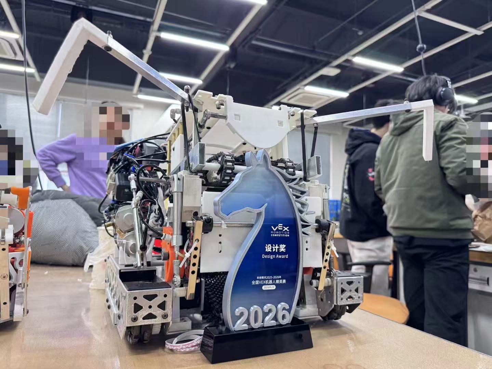
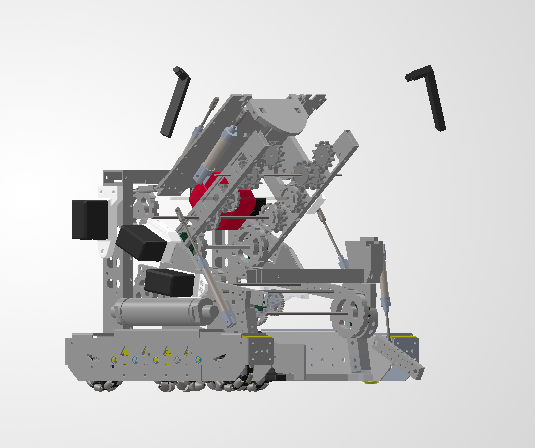
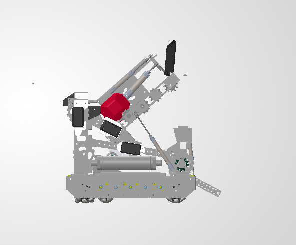

# TJU2 SmallBot

同济大学 TJU2 战队为 VEX U「Push Back」赛季打造的小型竞赛机器人。本仓库收录整车的可编辑 SOLIDWORKS 机械设计。

**2026 年 VEX U 设计奖（Design Award）** · 2026 年 2 月，同济大学 TJU2 战队凭该机器人在「科创青禾 2025–2026 全国 VEX 机器人精英赛暨 VEX 世锦赛中国选拔赛」VEX U 赛项中获得设计奖。

## 下载 SOLIDWORKS 源文件

[下载 CAD 包（ZIP，约 545 MiB）](https://github.com/liyuhengpiggy/TJU2-SmallBot/releases/download/v1.0.0/TJU2-SmallBot-SOLIDWORKS.zip) · [查看版本说明](https://github.com/liyuhengpiggy/TJU2-SmallBot/releases/tag/v1.0.0)

1. 将 ZIP 中的所有文件解压到同一目录，保留原文件名。
2. 在 SOLIDWORKS 中打开 `小车总装配.SLDASM`。
3. 在装配树中查看底盘及其他子装配，也可以单独打开零件模型。

| 文件类型 | 数量 | 内容 |
| --- | ---: | --- |
| `.SLDASM` | 6 | 整车装配和子装配 |
| `.SLDPRT` | 110 | 机械零件和装配所用组件模型 |

本预览使用原始 CAD 包。装配引用和所需的 SOLIDWORKS 版本待核验。归档范围为机械 CAD。

## CAD 视图

| 整车装配 | 侧视图 |
| --- | --- |
|  |  |

## 项目与组件来源

机械设计由同济大学 TJU2 战队完成。CAD 包包含带 `SJTUVEX` 标识的 VEX 部件模型。公开发布前将核对第三方模型来源、再分发权限和原创设计的许可范围。

## English summary

TJU2 SmallBot is Tongji University Team TJU2's small robot for the VEX U Push Back season. Team TJU2 received the **Design Award** at the VEX U division of the 2025–2026 national VEX competition and China qualifier for the VEX World Championship in February 2026. The CAD archive contains six native SOLIDWORKS assemblies and 110 part models. Open `小车总装配.SLDASM` to start with the top-level assembly.
